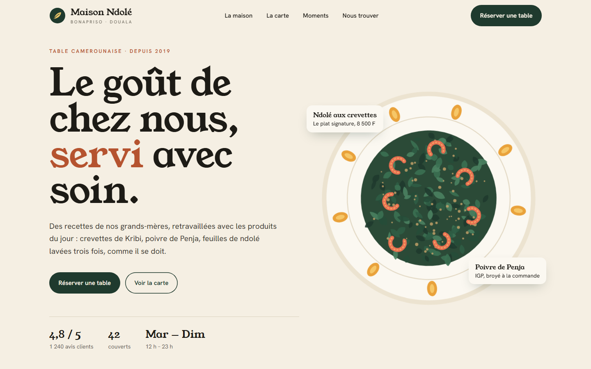
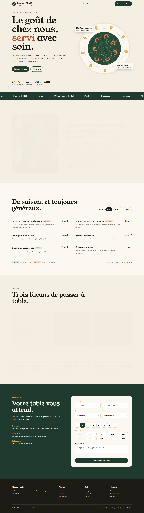
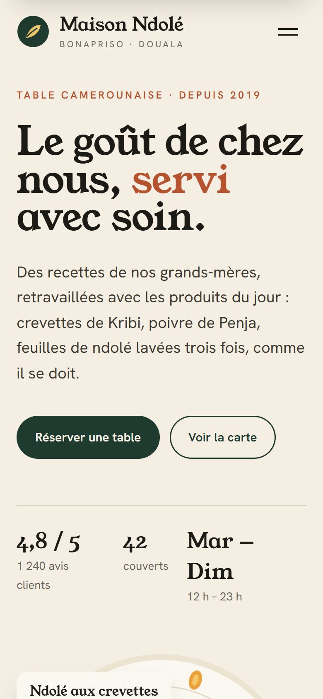

# Maison Ndolé

**Site vitrine · Restaurant** — Site vitrine d'une table camerounaise contemporaine à Douala : identité, carte interactive et réservation en ligne.

**Démo en ligne : [https://lordlennyx.github.io/maison-ndole/](https://lordlennyx.github.io/maison-ndole/)**

Spot de présentation (30 s) : [media/spot-30s.mp4](https://lordlennyx.github.io/maison-ndole/media/spot-30s.mp4)

## Ce que le projet montre

- Illustration d'assiette générée en SVG (unique, légère, animée)
- Carte du restaurant par onglets, données séparées du gabarit
- Réservation : couverts, créneaux disponibles selon la date, validation du numéro camerounais, fermeture du lundi
- Navigation fixe, menu mobile, apparitions au défilement, accessibilité (rôles ARIA, mouvement réduit)
- Aucune dépendance : un seul fichier HTML, chargement instantané

## Réalisation

- **Stack :** HTML, CSS, JavaScript natif, SVG
- **Typographies :** Young Serif, Hanken Grotesk
- **Poids :** moins de 40 Ko hors polices

| Bureau | Mobile |
|---|---|
|  |  |

---

Client et contenus fictifs, créés pour la démonstration. Conception, design et développement : **Njundiyimun Béchard** — [github.com/LordLennyx](https://github.com/LordLennyx)
